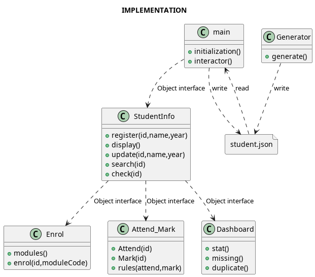

## Introduction
This is a coursework project of DataScience&Python.

This project includes:
- Project requirements document
- Python implementation code & structures
- Project documentation

## Project requirements document
[Project requirement pdf](doc/University_Management_System_Midterm_Project.pdf)

## Dataset

Use generator generates finctional dataset randomly.

- ### Attributes:
    - Student ID
    - name
    - year (e.g. 2026)
    - department
    - moduleCOde
    - moduleTitie
    - moduleTutor
    - Attendance
    - Mark

## Requirement
- Python
- pandas ``pip install pandas``
- matplotlib ``pip install matplotlib``

## Usage
install ``git clone https://github.com/WeiZheng-G/UniversityManagementSystem.git`` and ``cd UniversityManagementSystem``

Run ``python generator.py`` to generate random dataset

Run ``python main.py``

Enter ``<command>``:

- ``list``: Display student list
- ``register``: Enter information to register
- ``update``: Update exist student records
- ``search``: Search student info using student id
- ``modules``: List available modules
- ``enrol``: Enrol student on module using student ID and module code
- ``attend``: check student's attendance
- ``mark``: check student's mark
- ``rule``: change attendance&mark thresholds
- ``stat``: Plot bar&scatter&line graphs of mark verses year
- ``missing``: check dataset missing
- ``duplicate``: check dataset duplicating
- ``save`` to exit program with save
- ``exit`` to exit program without save

## Layout
```
├── data
│   └── student.json //Dataset file, used for load and save
├── doc
│   ├── University_Management_System_Midterm_Project.pdf
│   ├── structure.png
│   └── structure.puml
├── main.py //main processor
├── README.md
└── src
    ├── Attendance.py //attendance display, mark display, rules change
    ├── dashboard.py //statistics display, missing and duplicate check
    ├── Enrol.py //available modules display, enrol
    └── StudentInfo.py //attendance display, mark display, rules change
```

## Implementation
